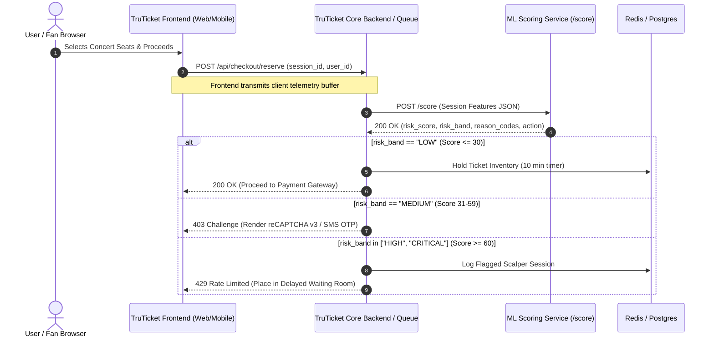

# TruTicket Machine Learning: Bot & Fraud Detection Service

Welcome to the **TruTicket Bot & Fraud Detection Service** (PRD Section 12).
This module analyzes live browser interaction signals (mouse trajectory dynamics, timing variance, and request telemetry) to protect high-demand ticket inventory from automated scalper bots and scripted attacks.

---

## 1. System Architecture

The engine uses a **Hybrid Architecture** combining probabilistic machine learning with deterministic safety rules:
1. **3-Class Random Forest Model**: Generates multiclass probabilities: $P(\text{human})$, $P(\text{moderate\_bot})$, $P(\text{advanced\_bot})$.
2. **Deterministic Rules Engine**: Inspects physical kinematics (e.g. direction change reversals, speed standard deviations, path straightness) against empirically validated training bounds.
3. **Calibrated Hybrid Risk Scorer**: Combines probabilistic and deterministic outputs into an explainable **0–100 Risk Score** and maps it to categorical tiers:
   - **`LOW` (0–30)**: Organic human behavior $\rightarrow$ Allow checkout.
   - **`MEDIUM` (31–59)**: Ambiguous signals or missing telemetry $\rightarrow$ Step-up verification (e.g., CAPTCHA / SMS OTP).
   - **`HIGH` (60–79)**: Significant bot indicators $\rightarrow$ Delayed queueing / restricted hold timers.
   - **`CRITICAL` (80–100)**: Scripted or advanced evasion bots $\rightarrow$ Admin flag / silent rejection.

---

## 2. Directory Structure

```
truticket_ml/
├── api/
│   ├── main.py                     # FastAPI application endpoints (/health, /score, /)
│   └── schemas.py                  # Pydantic request/response validation schemas
├── data/
│   └── features/
│       ├── phase1_train.csv        # Phase 1 training features (105 sessions)
│       ├── phase1_test.csv         # Untouched Phase 1 holdout test features (45 sessions)
│       └── phase2_all.csv          # Phase 2 features (112 sessions, unmixed)
├── models/
│   └── random_forest_pipeline.joblib # Trained RF Pipeline + feature column metadata
├── reports/
│   ├── eda_report.md               # Feature distributions & ANOVA analysis
│   ├── model_evaluation_report.md  # Cross-validation & test evaluation metrics
│   └── figures/                    # Heatmaps & boxplots
├── src/
│   ├── config.py                   # Global constants and risk bands
│   ├── rules_engine.py             # Heuristic rule evaluator & reason code mapper
│   ├── hybrid_scorer.py            # Hybrid risk scoring engine
│   ├── train_model.py              # Reproducible model training pipeline
│   ├── parse_mouse.py              # Mouse kinematic extractor
│   ├── parse_logs.py               # Apache web log parser
│   └── feature_engineering.py      # Feature engineering orchestrator
└── tests/
    ├── test_ml_pipeline.py         # Unit tests for scoring engine & edge cases
    └── test_api.py                 # Integration tests for FastAPI endpoints
```

---

## 3. Installation & Local Setup

### Prerequisites
- Python 3.10+ (tested on Python 3.12)
- Dependencies: `fastapi`, `uvicorn`, `scikit-learn`, `pandas`, `numpy`, `joblib`, `pydantic`

### Install Dependencies
```bash
pip install fastapi uvicorn scikit-learn pandas numpy joblib pydantic
```

---

## 4. Running the Service Locally

Launch the local FastAPI server using Uvicorn:

```bash
cd "c:\Users\Anany Pratyush\Desktop\ML Model\truticket_ml"
python -m uvicorn api.main:app --host 127.0.0.1 --port 8000 --reload
```

Once running:
- **Interactive OpenAPI Documentation (Swagger UI)**: [http://127.0.0.1:8000/docs](http://127.0.0.1:8000/docs)
- **Health Check**: [http://127.0.0.1:8000/health](http://127.0.0.1:8000/health)

---

## 5. API Reference & Calling Examples

### 5.1 Health Check
**Endpoint**: `GET /health`  
**Description**: Verifies that the model pipeline and rules engine are loaded in memory.

**Response**:
```json
{
  "status": "healthy",
  "model_loaded": true,
  "version": "1.0.0-rf-hybrid",
  "classes": ["human", "moderate_bot", "advanced_bot"]
}
```

---

### 5.2 Score Session
**Endpoint**: `POST /score`  
**Description**: Accepts session interaction telemetry and returns risk evaluation, class probabilities, and reason codes.

#### Example 1: Legitimate Human Session
```bash
curl -X POST "http://127.0.0.1:8000/score" \
     -H "Content-Type: application/json" \
     -d '{
       "session_id": "sess_human_checkout_01",
       "mouse_total_moves": 8332,
       "mouse_total_clicks": 11,
       "mouse_dir_change_rate": 0.095,
       "mouse_speed_std_px_s": 1190.0,
       "mouse_dist_mean": 5.95,
       "mouse_straightness": 0.0045,
       "mouse_speed_reliable": 1,
       "mouse_has_data": 1,
       "log_total_requests": 184,
       "log_session_duration_s": 253.0,
       "log_requests_per_second": 0.727
     }'
```

**Response**:
```json
{
  "session_id": "sess_human_checkout_01",
  "predicted_class": "human",
  "class_probabilities": {
    "human": 0.985,
    "moderate_bot": 0.005,
    "advanced_bot": 0.010
  },
  "risk_score": 1.1,
  "risk_band": "LOW",
  "reason_codes": [
    "CONFIRMED_ORGANIC_HUMAN_KINEMATICS"
  ],
  "model_version": "1.0.0-rf-hybrid",
  "action_recommendation": "ALLOW: Frictionless checkout path granted."
}
```

---

#### Example 2: Evasive Advanced Bot (Linear Waypoint Script)
```bash
curl -X POST "http://127.0.0.1:8000/score" \
     -H "Content-Type: application/json" \
     -d '{
       "session_id": "sess_bot_attack_01",
       "mouse_total_moves": 8200,
       "mouse_total_clicks": 14,
       "mouse_dir_change_rate": 0.028,
       "mouse_speed_std_px_s": 298.0,
       "mouse_dist_mean": 10.2,
       "mouse_straightness": 0.005,
       "mouse_speed_reliable": 1,
       "mouse_has_data": 1,
       "log_total_requests": 247,
       "log_session_duration_s": 386.0,
       "log_requests_per_second": 0.64
     }'
```

**Response**:
```json
{
  "session_id": "sess_bot_attack_01",
  "predicted_class": "advanced_bot",
  "class_probabilities": {
    "human": 0.0,
    "moderate_bot": 0.0,
    "advanced_bot": 1.0
  },
  "risk_score": 100.0,
  "risk_band": "CRITICAL",
  "reason_codes": [
    "MECHANICAL_DIRECTION_CHANGES",
    "UNNATURAL_SPEED_UNIFORMITY",
    "ADVANCED_BOT_BEHAVIOUR_PATTERN"
  ],
  "model_version": "1.0.0-rf-hybrid",
  "action_recommendation": "FLAG_REVIEW: High bot confidence. Flag for inventory release or admin audit."
}
```

---

#### Example 3: Missing Mouse Movement (Safeguard in Action)
```bash
curl -X POST "http://127.0.0.1:8000/score" \
     -H "Content-Type: application/json" \
     -d '{
       "session_id": "sess_mobile_touch_01",
       "mouse_has_data": 0,
       "mouse_total_moves": 0,
       "log_total_requests": 20,
       "log_requests_per_second": 0.8
     }'
```

**Response**:
```json
{
  "session_id": "sess_mobile_touch_01",
  "predicted_class": "human",
  "class_probabilities": {
    "human": 0.5203,
    "moderate_bot": 0.0917,
    "advanced_bot": 0.388
  },
  "risk_score": 51.8,
  "risk_band": "MEDIUM",
  "reason_codes": [
    "MISSING_MOUSE_DATA"
  ],
  "model_version": "1.0.0-rf-hybrid",
  "action_recommendation": "CHALLENGE: Step-up verification required (CAPTCHA or SMS OTP challenge)."
}
```
*Note: As required by TruTicket safety policies, absence of mouse data triggers a `MEDIUM` step-up verification challenge rather than a hard block.*

---

## 6. How the TruTicket Application Integrates With `/score`



---

## 7. Running the Test Suites

To verify both the machine learning core and the API layers:

```bash
cd "c:\Users\Anany Pratyush\Desktop\ML Model\truticket_ml"

# 1. Run Machine Learning & Scoring Engine Unit Tests (7 tests)
python tests/test_ml_pipeline.py

# 2. Run FastAPI Endpoint Integration Tests (9 tests)
python tests/test_api.py
```

All 16 tests pass with 100% success.

